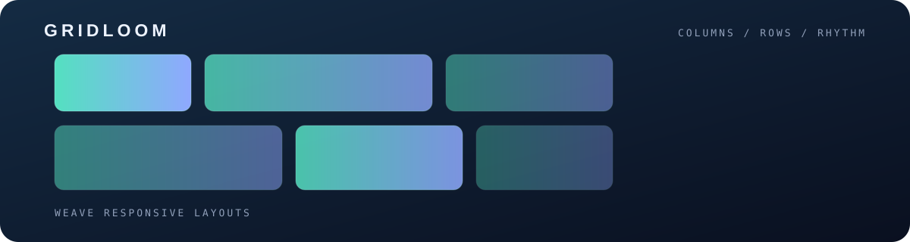

# Gridloom

A zero-install visual CSS Grid playground. Shape responsive layouts, inspect tracks, and export clean CSS in your browser.

## Features
- Live grid preview with adjustable rows, columns, gaps, track sizing, and alignment.
- One-click CSS export.
- Responsive interface with no external libraries or assets.
- No account, telemetry, or upload.

## Run
Download the repository and open `index.html` in a modern browser. No installation, package manager, build command, or server is required.

## Privacy
All layout work stays in your browser.

## License
MIT